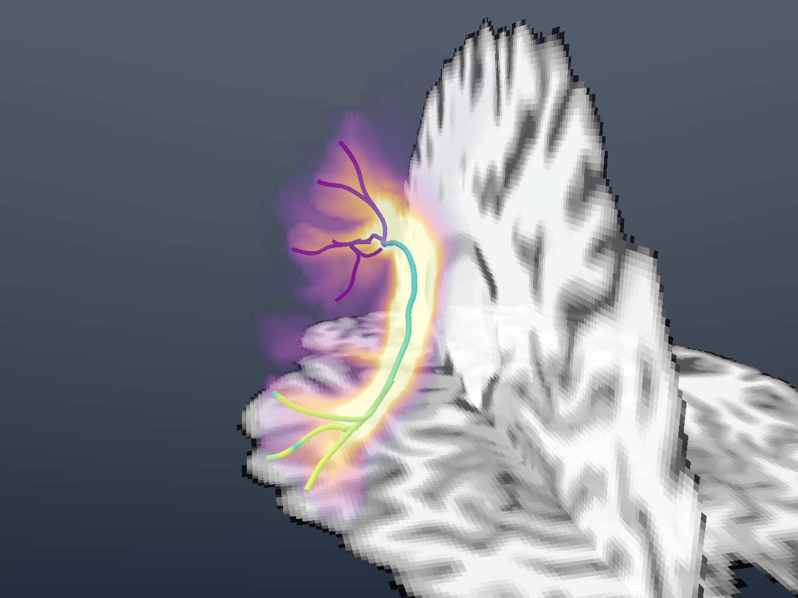
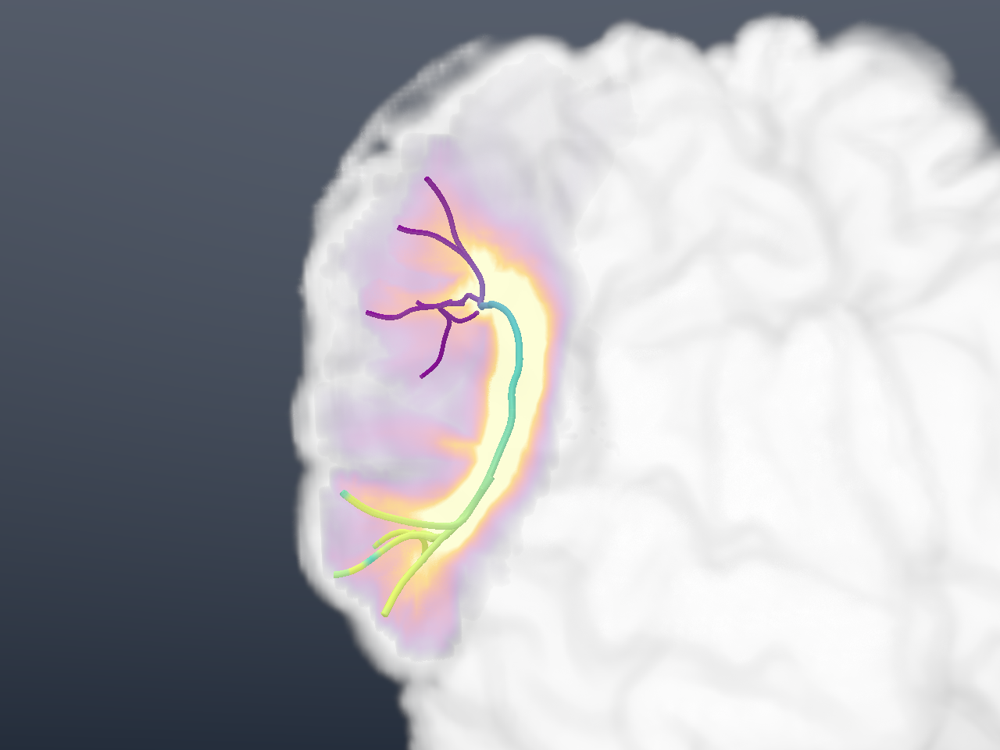
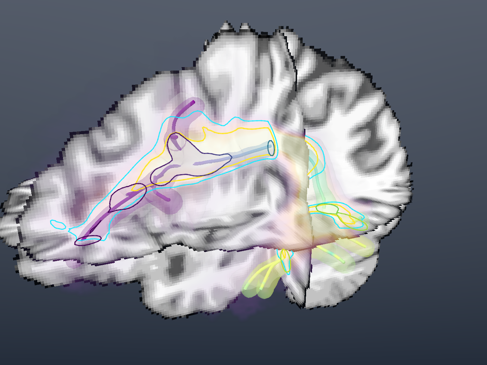
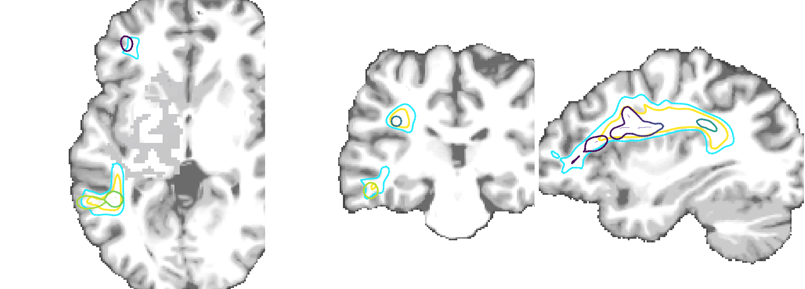

# GUI Guide

## Modes

TRXViz is designed around two usage modes:

- **Simple**: a constrained asset-first editor that exposes common display and workflow-affecting controls without showing the graph pane
- **Advanced**: the full pane-based workspace, including graph editing, asset inspection, and unrestricted workflow editing

This is an intentional split, not two symmetric shells. Simple mode is the simplified editor surface.
Advanced mode is the workspace.

The desktop app combines:

- a 3D perspective viewer
- an optional `Inflated Stage` pop-out viewer for non-anatomical cortical layouts (like inflated or Very Inflated surfaces)
- axial, coronal, and sagittal slice views
- asset and inspector panes
- workflow graph editing when advanced mode is enabled

## What Each Mode Actually Does

### Simple

Simple mode is for the common case where you want to:

- open assets and get a seeded workflow branch automatically
- adjust visibility, color, display style, and a small set of workflow-backed controls
- work asset-by-asset without reasoning about graph topology

Simple mode uses the workflow document underneath, but only exposes edits that can be mapped onto
the existing simple bindings. If a project stops fitting that model, the app will tell you to
switch to Advanced mode.

Examples of Advanced-only situations include:

- branches with multiple terminal displays for the same asset
- CIFTI workflow editing
- ODX-specific graph editing
- assets whose workflow branch has been routed through additional nodes that no longer map cleanly
  onto the simplified controls

### Advanced

Advanced mode is the normal workspace UI:

- preview pane
- assets pane
- graph pane
- inspector pane

Use it when you need to edit the workflow graph directly, inspect node ports and parameters, or
work on projects that exceed the Simple-mode constraint solver.

## What The GUI Is Best For

- exploratory viewing
- debugging workflow results interactively
- tuning display settings before generating figures
- inspecting slice alignment, bundle/surface overlays, and CIFTI-driven surface appearance

## Export Behavior

TRXViz can export anatomical 3D, inflated-stage, and 2D views to PNG.

- 3D exports capture the 3D viewer state
- Inflated-stage exports capture the `Inflated Stage` pop-out state
- 2D exports capture the selected 2D presentation mode
- scale multiplies the current viewport resolution

For batch figure generation, prefer the CLI so output can be scripted and reproduced.

If you save the project first, `trxviz-cli render --project workflow.json --view 2d` reproduces
the saved 2D viewer state headlessly.

If you save the project first, `trxviz-cli render --project workflow.json --view stage` reproduces
the saved inflated-stage layout headlessly.

## Inflated Stage

`Inflated Stage` is a pop-out-only viewer for non-anatomical cortical surface presentations.

- Open it from the preview toolbar using `Open Inflated Stage`.
- It renders surfaces whose `SurfaceDisplay.space` is set to `Stage`.
- It does not use anatomical axis markers, because the displayed layouts are not in anatomical
  world space.
- Its `Export` menu supports `PNG` and `Blender (GLB)`.

This is the intended presentation surface for inflated or spherical cortical GIFTI meshes and for
CIFTI-driven cortical displays that should not appear in the main anatomical 3D scene.

## Surface Placement

`SurfaceDisplay.space` controls where a surface display appears:

- `Anatomical` renders in the main 3D viewer.
- `Stage` renders in `Inflated Stage`.

Surfaces whose filenames suggest non-anatomical layouts, such as bounded `inflated` or `sphere`,
may default to `Stage` when first added to a workflow branch.

## Surface Overlay Stack

`SurfaceOverlayStack` builds a styled surface appearance from one target surface plus ordered
scalar layers.

- Layer 0 is the base layer and also provides the fallback base color when no scalar input is connected.
- Each layer has its own colormap, numeric range, thresholding, opacity, visibility, and legend label.
- `dlabel` overlays can use attached label-table colors instead of numeric colormaps.
- CIFTI cortex outputs and streamline-derived surface scalars can both feed the same overlay stack.

### Layer controls

Each layer in the inspector exposes the following controls. Controls marked *(scalar input required)*
only have a visible effect when a scalar input is connected to that layer's input port.

**Enabled** — toggles the layer on or off. Disabled layers are skipped entirely; the layer beneath
shows through.

**Legend label** — text shown in the figure legend. Purely cosmetic.

**Fallback base color** *(base layer only)* — the RGBA color applied to every vertex before any
scalar overlays are blended. This is what you see when no scalar input is connected to layer 0, or
for any vertex not reached by an enabled overlay.

**Opacity** — *(scalar input required)* the alpha value blended over lower layers for each
colored vertex. 1.0 fully replaces the color below; 0.0 makes the layer invisible. Vertices that
are skipped by thresholding are unaffected and remain fully transparent to this layer.

**Use label table colors** *(scalar input required)* — for `dlabel` scalar inputs, uses the
integer label index to look up RGBA colors from the attached label table instead of the colormap.
When this is on, the Colormap, Min, Max, and threshold controls are all ignored.

**Colormap** *(scalar input required, disabled when "Use label table colors" is on)* — the color
ramp mapped across the scalar range. Values at Min receive the first ramp color; values at Max
receive the last.

**Min / Max** *(scalar input required)* — the scalar range that spans the full colormap. Values
outside this range are clamped to the nearest endpoint rather than hidden. When the scalar
metadata includes a suggested range, that range is used and these fields act as a fallback only.

**Thresh min / Thresh max** *(scalar input required)* — a hard visibility gate. Vertices whose
scalar value falls below Thresh min or above Thresh max are skipped (not colored), letting the
layer beneath show through. Defaults to −∞ / +∞ (no thresholding). Useful for masking
low-density regions or clipping outliers.

## 3D Volume Rendering (`2D Slices Only` / `3D MIP` / `3D Direct Volume`)

Every `VolumeDisplay` node (accessible in both Simple mode and Advanced mode) exposes a **3D Render Mode** selector (`render_3d_mode`) alongside eight scientific colormaps (`Grayscale`, `Hot`, `Jet`, `Cool`, `Inferno`, `Magma`, `Plasma`, and `Viridis`):

- **`Off` (`2D Slices Only`)**: Renders axial, coronal, and sagittal slice planes in the 3D viewport and 2D slice panels. Zero-intensity background voxels (`intensity <= 1e-6`) are discarded in the fragment shader so skull-stripped anatomical volumes (`T1w`) and masked scalar maps never occlude 3D streamlines or 3D ray-marched volumes with black bounding-box corners.
- **`Mip` (`3D MIP`)**: Performs 160-step GPU ray-marching through the 3D volume bounding box in RAS+ space, accumulating Maximum Intensity Projection and subtle emission glow along each ray (`pow(max_val, 0.75)` alpha curve). Ideal for continuous bundle density fields (e.g., AFD or probability maps) where fine offshoots and branches should glow in 3D without hard iso-surface thresholding.
- **`DirectVolume` (`3D Direct Volume`)**: Performs front-to-back emission-absorption compositing through the 3D volume. Can be used either for dense volumetric clouds or at low opacity (`0.15–0.22`) on a `T1w` volume to create a translucent 3D **glass brain** shell around internal tracts.

When a scene combines 2D anatomical slices (`Off`) with 3D ray-marched volumes (`Mip` or `DirectVolume`), TRXViz renders the 2D slice planes first with depth writes enabled, then composites the 3D ray-marched proxy cubes over the scene with depth-read enabled and depth-write disabled.





## Cross-Sectional Bundle Surfaces & Slice Intersection Contours

To visually parse how a 3D streamline bundle or branching arbor passes through the 2D anatomical slices, TRXViz supports surrounding streamlines with translucent 3D cross-sectional surfaces that automatically project crisp **contour lines** onto every intersecting axial, coronal, and sagittal slice plane:

1. **Native Streamline Density Envelope (`BundleSurfaceBuild` $\to$ `BundleSurfaceDisplay`)**:
   - `BundleSurfaceBuild` (`build_mode: MarchingCubes`) voxellizes the input streamlines onto a 3D density grid, applies 3D Gaussian smoothing (`smooth_sigma`), and extracts a Marching Cubes boundary mesh.
   - When `smooth_sigma >= 0.5`, the per-voxel streamline color accumulators (`r_sum`, `g_sum`, `b_sum`) and tangent covariance sums are Gaussian-blurred alongside the density field (Nadaraya-Watson kernel interpolation). Setting `BundleSurfaceDisplay.color_mode` to `SourceColors` therefore colors both the 3D translucent shell and its slice contour rings by the exact local streamline color (such as a `Viridis` harmonic coordinate or DPV scalar).
2. **External GIFTI Iso-Surfaces (`SurfaceSource` $\to$ `SurfaceOverlayStack` $\to$ `SurfaceDisplay`)**:
   - Load one or more `.surf.gii` meshes (for example, nested 50% core and 82% outer AFD mass iso-shells) and configure `color`, `opacity`, `outline_color`, and `outline_thickness` on each `SurfaceDisplay`.

Whenever `outline_thickness > 0`, TRXViz intersects every visible `SurfaceDisplay` and `BundleSurfaceDisplay` mesh with the active slice planes (`intersect_mesh_with_plane`) and draws the resulting contour rings in both the **3D perspective viewport** and the **2D slice viewports** (as well as in headless `trxviz-cli render --view 3d` and `--view 2d` PNG exports). In the 3D viewport, contour segments on one slice plane are automatically occluded when passing behind non-zero brain voxels of another visible slice plane in front of the camera.





## Saving And Reusing The 3D Camera

Workflow project saves now include the current 3D camera under `document.camera_3d` and the 3D
slice state under `document.slice_view_3d`.

- Save the workflow project after framing the view you want.
- Reopen the project later to restore the same 3D target, azimuth, elevation, distance, and
  axial/coronal/sagittal slice positions and visibility.
- GUI project saves also restore the 2D slice-view mode and per-slice pan/zoom state.
- Use `View > Copy 3D Camera JSON` or the `Copy 3D Camera` button in the preview toolbar to copy
  a JSON snippet you can paste under the `document` object in a workflow project manually.

Example snippet:

```json
{
  "camera_3d": {
    "target": [12.3, -18.0, 42.1],
    "azimuth_deg": 45.0,
    "elevation_deg": 25.0,
    "distance": 180.0
  },
  "slice_view_3d": {
    "visible": [true, false, true],
    "positions_ras": [10.0, 20.0, 30.0]
  }
}
```
